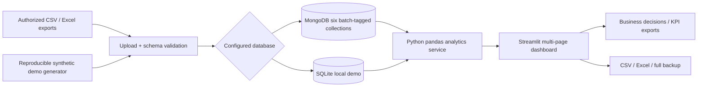
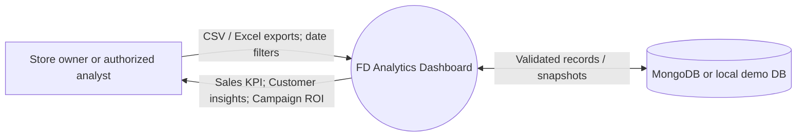
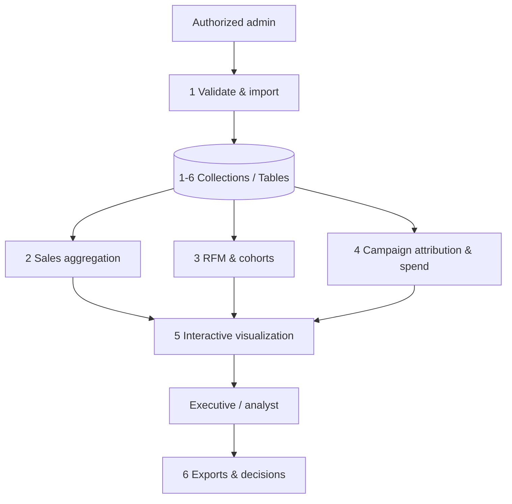

# Architecture, Data Flow and Mapping

## Logical architecture



## Logical entity model

```mermaid
erDiagram
    CUSTOMERS ||--o{ ORDERS : purchases
    ORDERS ||--|{ ORDER_ITEMS : includes
    PRODUCTS ||--o{ ORDER_ITEMS : sold_as
    MARKETING_CAMPAIGNS ||--o{ CAMPAIGN_CONVERSIONS : gets
    ORDERS ||--o| CAMPAIGN_CONVERSIONS : attributed_to
    CUSTOMERS ||--o{ CAMPAIGN_CONVERSIONS : generates
    CUSTOMERS { string customer_id PK; string name; date signup_date; string region }
    PRODUCTS { string product_id PK; string name; string category; float unit_price; float unit_cost; integer stock }
    ORDERS { string order_id PK; string customer_id FK; date order_date; string status; string payment_method; float total_amount }
    ORDER_ITEMS { string item_id PK; string order_id FK; string product_id FK; integer quantity; float unit_price }
    MARKETING_CAMPAIGNS { string campaign_id PK; string name; string channel; date start_date; date end_date; float spend; integer impressions; integer clicks }
    CAMPAIGN_CONVERSIONS { string attribution_id PK; string campaign_id FK; string order_id FK; string customer_id FK }
```

## Context DFD / Level 0



## DFD / Level 1



## Database modes

- **MongoDB (recommended to show in Phase 2):** data inserted into batch-tagged collections, active batch switched only after all inserts; older batch cleaned afterward; Mongo Compass can show the six collections.
- **SQLite (offline fallback):** creates six SQL tables with a single write transaction, with `fd_metadata` and `fd_audit`. This works without installing MongoDB.
- **No actual streaming/API integration:** uploads and generated resets are deliberate writes followed by refreshed computations.

## Functional requirements

| ID | Requirement | Implementation |
|---|---|---|
| FR-01 | View revenue trends | Executive, Sales pages |
| FR-02 | Analyze customer preferences | RFM, cohorts, region and payment |
| FR-03 | Evaluate campaign ROI | Single-touch attribution and prorated marketing cost |
| FR-04 | Filter by date/category/region | Sidebar and sales-line joins |
| FR-05 | Integrate data into MongoDB | `MongoRepository`, `DATA_BACKEND=mongodb` |
| FR-06 | Import CSV/Excel | Admin Data Studio, strict six-table import |
| FR-07 | Export KPIs and backup | Sales and marketing CSV/XLSX; raw full CSV ZIP for admins |
| FR-08 | Data consistency and audit log | Schema validator, persistence metadata, audit entries |
| FR-09 | Business decision support | Grounded rule-based recommendations, scenario arithmetic |
| FR-10 | Presentation and repeatable tests | Faculty Guide, pytest |

## Non-functional requirements

- Usable with a browser, Python runtime and local demo database.
- Protect database credentials in untracked `.env` and prohibit real customer data in public prototype.
- Consistent, labelled synthetic / imported provenance.
- Reproducible seed and consistent calculations with unit tests.
- Limit uploads to reasonable table size (100k rows each in this educational build); Streamlit max upload 25MB.
- No production SLAs, enterprise-grade access control or payment gateway are claimed.
